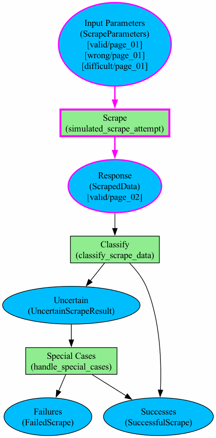

# Petritype

Typed, executable, visual Petri nets in Python.

Petritype turns [Petri nets](https://en.wikipedia.org/wiki/Petri_net) into a practical tool for building and visualising data processing pipelines. Places are typed containers, transitions are real Python functions, and tokens are your actual data — Pydantic models, dataclasses, primitives, whatever you need. Types are enforced at runtime, so wiring errors surface immediately rather than silently propagating.

*Early stage — contributions and feedback welcome.*

<p align="center"></p>

**Contents:** [Core Idea](#core-idea) · [Quickstart](#quickstart) · [Key Features](#key-features) ([Input edges at a glance](#input-edges-at-a-glance), [Nets as tokens](#nets-as-tokens), [Subnet places](#subnet-places), [Closed nets](#closed-nets), [Token keys](#token-keys-and-queries)) · [Runtime](#runtime--observable-interactive-nets) · [Net protocol](#net-protocol--run-a-net-as-a-process) · [Installation](#installation) · [Examples](#examples)

## Core Idea

A Petri net has two kinds of nodes connected by directed edges:

- **Places** (blue ovals) — typed containers that hold tokens
- **Transitions** (green rectangles) — functions that consume tokens from input places and produce tokens into output places

A transition can only fire when all of its input places have tokens available, though a [drain, survey, or read-all edge](#edges-that-accept-an-empty-place) accepts an empty place. When it fires, it pops tokens from input places, calls its function, and routes the result to output places based on type matching. The current set of tokens across all places represents the live state of the system.

Petritype adds a type system on top of this: each place declares the Python type it accepts, and every token is checked against that type. This means the graph itself encodes the shape of your data pipeline — what types flow where, what each function expects, and where different outcomes end up.

## Quickstart

```python
import asyncio
from petritype.core.executable_graph_components import (
    ExecutableGraphOperations,
    FunctionTransitionNode,
    ListPlaceNode,
    ArgumentEdgeToTransition,
    ReturnedEdgeFromTransition,
)

# 1. Define your types and functions
def double(x: int) -> int:
    return x * 2

# 2. Build the graph
graph = ExecutableGraphOperations.construct_graph([
    ListPlaceNode('Input', int, [1, 2, 3]),
    ArgumentEdgeToTransition('Input', 'Double', 'x'),
    FunctionTransitionNode('Double', double),
    ReturnedEdgeFromTransition('Double', 'Output'),
    ListPlaceNode('Output', int),
])

# 3. Execute
graph, fired = asyncio.run(
    ExecutableGraphOperations.execute_graph(graph, stop_after_n_firings=3)
)

print(graph.place_named('Output').tokens)  # [2, 4, 6]
```

`construct_graph` takes a flat list of places, transitions, and edges in any order — it sorts them out. Execution runs an async loop: find fireable transitions, select one, fire it, repeat. All primary node, edge, runtime, and error types are also re-exported directly from the top-level `petritype` package (`from petritype import ExecutableGraphOperations, ListPlaceNode, FunctionTransitionNode, Runner, RunContext, ExecutionMode, PetritypeError, ...`).

## Key Features

### Runtime type checking

Places declare types. Tokens are validated on entry. If a transition returns a `str` but the output place expects `int`, you get an immediate error — not a silent downstream failure.

```python
ListPlaceNode('Scores', float, [0.95, 0.87])   # only accepts float tokens
ListPlaceNode('Labels', str, ['cat', 'dog'])     # only accepts str tokens
```

Type matching also governs output routing: when a transition has multiple output places, the result is sent to the place whose type matches.

### Static structure checks

For pipeline-shaped nets you can prove termination before running anything: `construct_graph(..., expect_acyclic=True)` (or `ExecutableGraphCheck.assert_acyclic(graph)`) rejects token cycles at build time, naming the offending path (`P1 → T1 → P2 → T2 → P1`). Acyclicity alone is not termination — a *source* transition that consumes no tokens fires forever in a perfectly acyclic net — so pair it with `ExecutableGraphCheck.assert_no_source_transitions(graph)`; a net that passes both provably quiesces. Nets that are cyclic or source-fed on purpose get run-time bounds instead (`error_after_n_firings`).

### Failure semantics

If a transition body raises, the firing fails with `TransitionFailedError`. The tokens it consumed are **not** put back: the body may have mutated them before failing, and a place should never silently hold corrupted tokens — a visible loss beats invisible corruption. The consumed tokens ride along on the error:

```python
try:
    await ExecutableGraphOperations.execute_graph(graph)
except TransitionFailedError as e:
    e.transition_name   # 'Charge Card'
    e.consumed          # {'order': <the consumed token>}
    e.__cause__         # the original exception
```

*Expected* failures are the body's job: catch them and return an error token, and type-based routing (e.g. `-> Receipt | FailedOrder`) delivers it to an error-handling place. If your tokens are immutable or bodies don't mutate them before failing, `restore_tokens_on_failure=True` (on `construct_graph` or per `execute_graph` call) opts into putting consumed tokens back.

All library-specific exceptions (`TransitionFailedError`, `ClosedNetError`, `HeldByBodyError`, `LaunchNotificationError`, `SubnetHeldError`, `TooManyFiringsError`) inherit from `PetritypeError` as well as their standard `ValueError` or `RuntimeError` base, so callers can catch `PetritypeError` cleanly without catching unrelated Python errors.

### Async execution

Transition functions can be `async`. The execution loop handles both sync and async functions transparently.

```python
async def fetch(url: str) -> str:
    async with aiohttp.ClientSession() as session:
        async with session.get(url) as resp:
            return await resp.text()

FunctionTransitionNode('Fetch', fetch)
```

### Guards, priorities, and transition selectors

Each transition can carry two optional callables. Both receive the live graph, so they can read the whole marking:

- **`guard`** — a firing condition the engine enforces in every execution mode: a transition whose guard returns `False` is not fireable, regardless of available tokens. Guards run on every fireable-discovery sweep, so keep them cheap, side-effect-free predicates over the marking.
- **`priority`** — a selection hint: the default selector fires the highest-priority fireable transition. Unset scores `0.0`; ties fall back to definition order. `tie_break` (on `construct_graph` or the graph) picks which end: `"first_declared"` (default) runs a FIFO pipeline in batches, every token through stage one before any reaches stage two, while `"last_declared"` lets each token flow through before the next enters, and `"round_robin"` takes the live transitions in turn, each pick the first one declared after the last.

```python
# Guard: BatchProcess is not fireable until the pool is full
def batch_ready(graph) -> bool:
    return len(graph.place_named('Pool').tokens) >= 10

# Priority: drain the longest queue first
def queue_pressure(graph) -> float:
    return len(graph.place_named('Queue').tokens)

FunctionTransitionNode('BatchProcess', batch_process, guard=batch_ready)
FunctionTransitionNode('Drain', drain, priority=queue_pressure)
```

For full control over what fires next, replace the selector itself — a function from the fireable transitions to the one to fire:

```python
graph.transition_selector = my_selector   # (graph, fireable) -> transition or None
```

The older `activation_function` field is deprecated: the engine never consulted it, so use `guard` or `priority` instead. It remains visible to custom selectors until removed.

A selector is just a callable over the fireable transitions, so round-robin, bottleneck-aware and other policies are a few lines each.

### Visualisation

> Needs the `viz` extra: `pip install 'petritype[viz]'`, plus the Graphviz `dot`
> binary on your PATH (`brew install graphviz` / `apt install graphviz`).

Built-in Graphviz rendering shows the graph structure, types, and current token state — including the non-consuming edges (dashed, dotted, or with dot ends) and, in concurrent runs, in-flight transitions highlighted while their bodies run. The example notebooks (marimo) step through and animate execution live.

```python
from petritype.plotting.rustworkx_graph import RustworkxGraph
from petritype.plotting.simple_graphviz import SimpleGraphvizVisualization

# The renderer draws a rustworkx view of the net, built once from the graph
pydigraph = RustworkxGraph.from_executable_graph(graph)

# Static graph image
SimpleGraphvizVisualization.graph(pydigraph)

# Step-by-step animation, inside a notebook (`display` comes from marimo/IPython)
async for step, diagram, fired in SimpleGraphvizVisualization.animate_execution_generator(
    graph, pydigraph
):
    display(diagram)
```

### Output distribution

When a transition has multiple output places, tokens are routed by type matching. For custom routing logic, provide an output distribution function:

```python
def route_result(result) -> dict[str, Any]:
    if result.score > 0.9:
        return {'Approved': result}
    else:
        return {'NeedsReview': result}

FunctionTransitionNode(
    'Classify', classify,
    output_distribution_function=route_result,
)
```

### Token copying

When a transition produces a token that matches multiple output places by type, Petritype raises an error by default — this prevents accidental duplication. If you want the same token to be sent to multiple output places (via `deepcopy`), enable token copying when constructing the graph:

```python
graph = ExecutableGraphOperations.construct_graph([...], allow_token_copying=True)
```

This is useful when the same piece of data needs to flow down multiple independent paths — for example, a configuration token consumed by both a planning stage and a data-fetching stage.

### Input edges at a glance

Petritype provides ten input edge classes depending on whether a transition consumes tokens, mutates them in place, reads them live or as deep copies, filters by keys, or accepts an empty place:

| Edge class | Consumes? | Deep-copies? | Accepts empty? | Filter / bound? | Concurrent lock | Graphviz style |
| --- | :---: | :---: | :---: | :---: | --- | --- |
| `ArgumentEdgeToTransition` | Yes | No | No | No | Exclusive (token or place in list-mode) | Solid arrow |
| `TakeWhereEdge` | Yes | No | No | Yes | Exclusive (matched token) | Solid arrow + filter |
| `DrainEdge` | Yes (all) | No | Yes (`[]`) | No | Exclusive (whole place) | Solid hollow arrow |
| `SnapshotEdge` | No | Yes | No | No | Shared check at launch (none held) | Dashed arrow |
| `SurveyEdge` | No | Yes (all) | Yes (`[]`) | No | Shared check at launch (none held) | Dashed hollow arrow |
| `MutateEdge` | No | No (live) | No | No | Exclusive (token or place in list-mode) | Bold dot-ended line |
| `MutateWhereEdge` | No | No (live) | No | Yes | Exclusive (matched token) | Bold dot-ended + filter |
| `ReadEdge` | No | No (live) | No | No | Shared (front token) | Dotted arrow |
| `ReadWhereEdge` | No | No (live) | No | Yes | Shared (matched token) | Dotted arrow + filter |
| `ReadAllEdge` | No | No (live, all) | Yes (`[]`) | No | Shared (whole place) | Dotted hollow arrow (`*`) |

### List-mode transitions

If a transition argument is typed as `list[T]` and the input place holds tokens of type `T`, all tokens are passed as a list in a single call — useful for batch operations.

```python
def summarise(items: list[str]) -> str:
    return f"Processed {len(items)} items"

# All str tokens from 'Items' are passed at once
ArgumentEdgeToTransition('Items', 'Summarise', 'items')
```

### Edges that accept an empty place

Every edge above waits for a token: a transition never fires while one of its input places is empty. For a place a transition only needs to look at when something is there, where none is a perfectly good answer, two edges read **every token, zero or more**, and never hold the transition back. Both need a `list[T]` argument, checked when the graph is built:

- **`DrainEdge`** — takes every token, as a list-mode argument does, but an empty place hands the body `[]` instead of holding it back.
- **`SurveyEdge`** — a deep copy of every token, possibly none; nothing is consumed.

```python
from petritype.core.executable_graph_components import DrainEdge, SurveyEdge

def price_order(order: str, promotions: list[str]) -> tuple[str, list[str]]:
    return order, [f"{promotion} on {order}" for promotion in promotions]

def go(cars: list[str], light: str) -> list[str]:
    return cars

SurveyEdge('Promotions', 'Price Order', 'promotions')  # prices an order whether or not a promotion runs
DrainEdge('Waiting', 'Go', 'cars')                     # every car waiting goes past the light at once
```

A third edge, `ReadAllEdge` (below), hands over every token as the survey does, without copying any. A transition whose only argument edge is a drain consumes nothing on an empty place, so `assert_no_source_transitions` counts it as a source. The traffic light's `Go` is one: its guard, green and someone waiting, is what keeps it from firing on an empty queue. The worked examples are `examples/edges_on_empty_places/shop.py` for the survey and `examples/edges_on_empty_places/traffic_light.py` for the drain, beside a plain snapshot; the renderer draws both edges with a hollow arrowhead.

### Non-consuming edges

A transition can be handed a place's tokens without consuming them, through a **non-consuming edge**, one that leaves its token in its place: useful for parameters, toggles, or guard state, kept as visible, pokable nodes. Each of these requires a token to be present for the transition to be fireable, but firing never consumes it:

- **`SnapshotEdge`**: the transition receives a deep copy; the place is untouched.
- **`MutateEdge`**: the transition receives the live tokens and may modify them in place.

```python
from petritype.core.executable_graph_components import SnapshotEdge, MutateEdge

SnapshotEdge('Multiplier', 'Scale', 'factor')   # Scale reads Multiplier, never consumes it
MutateEdge('Counter', 'Scale', 'tally')          # Scale increments Counter in place
```

Three **read edges** hand the body tokens to look at, live, without taking or copying them: nothing moves, no id changes, and no event tells of them.

- **`ReadEdge`**: the front token; the transition waits while the place is empty.
- **`ReadWhereEdge`**: the oldest token a filter keeps (`where=Filter(...)`, as for the keyed edges below); the transition waits while there is none.
- **`ReadAllEdge`**: every token, oldest first, as a list, possibly empty, so it never holds the transition back; its argument is annotated `list[T]`.

```python
from petritype.core.executable_graph_components import ReadAllEdge, ReadEdge
from petritype.core.keys import Clause, Filter, ReadWhereEdge

ReadAllEdge("Barracks", "Call the Roll", "squads")      # every squad, none taken
ReadEdge("Barracks", "Check the Front", "squad")         # the front squad
ReadWhereEdge("Barracks", "Inspect", "squad",            # the squad the inspection names
              where=Filter((Clause("leader", input="Inspections", input_key="leader"),)))
```

The body gets the live token, so leaving it unchanged is the author's promise, which Python cannot enforce: a body that changes what it reads changes the token in its place, and nothing tells of it. A mutate edge is the edge for changing a token. A read edge is the way to look at a token that carries a net: a snapshot copies the net under a new `net_id`, where a read edge hands over the net itself, which keeps its id. A place a read edge reads is read by no other input edge of the same transition, which the build checks. `tests/protocol_nets/roll_call.py` is a small net that uses all three on a place of squads that are nets.

The renderer draws a snapshot as a dashed arrow, a mutate edge as a thicker line with dot ends, and a read edge as a dotted arrow, distinct from the solid consuming / producing arrows: a survey and a read-all have a hollow arrowhead, a read-all is labelled `*`, and a read-where carries its filter.

### Nets as tokens

A token can hold Petri nets of its own. Declare the place `nested=True`; each token is then an `ExecutableGraph` or any object with a `__petritype_nets__()` method naming the nets it holds. The outer net runs the inner nets as part of running itself, one firing at a time anywhere in the tree, in the order the place's **stepping rule** gives: `stepping="inner_first"` (the default) lets the place's nets come to rest before the outer net fires, `"take_turns"` has them and the outer net fire in turn, so an outer net that can always fire starves none of them, `"outer_first"` lets them fire only when the outer net has nothing to fire, and `"passive"` leaves them to the bodies that step them. Each level follows the rules of its own places. The outer net gathers the inner nets' events into its own log as `Nested` records carrying the path to the net they happened in, a tuple of `PathStep(place, token, net)`, tells a firing inside as an `InnerFiring(path, transition)`, and lets its bodies reach inside the tokens they hold:

```python
from petritype.core.nested import NestedNets

class Vehicle(BaseModel):
    name: str
    cabin: ExecutableGraph                       # an inner net, built from a template
    def __petritype_nets__(self):
        return {"cabin": self.cabin}

def board(passenger: str, vehicle: Vehicle) -> None:
    NestedNets.put(vehicle.cabin, "Door", [passenger])   # the only way in: through the token

ListPlaceNode("Depot", Vehicle, [bus], nested=True, stepping="outer_first")
MutateEdge("Depot", "Board Depot", "vehicle")
```

Inner nets never touch the outer net. A net also carries **net parameters** (`construct_graph(..., params={"stopped": True})`), read by guards as `graph.params` and handed to a body that declares a parameter of the same name. `examples/tokens_as_nets/transit.py` is the worked example: buses and ferries whose cabins are nets, each carrying its state as where its door tokens are, in its cabin's `Doors Open` or `Doors Closed`, which the city's guards read, so the net runs its journey on its own.

A token's net may mark places as **ports**, `ListPlaceNode("Orders In", str, port=True)`, as a [subnet](#subnet-places) does, to say where the net around it may reach in: a net that marks a port is [closed](#closed-nets) to writes from outside at its other places. An input edge on the place of such tokens may name the ports its body reaches, given by keyword on every input edge kind:

```python
MutateEdge("Field", "Hand Over", "unit", reaches=("Orders In",))   # hands the unit an order
MutateEdge("Field", "Collect", "unit", reaches=("Shots Out",))     # collects its shots
```

`reaches` is a declaration, as a group is: it changes nothing about firing, and nothing checks that the net has the ports named; which places of the net the body may write is the rule on [closed nets](#closed-nets). The build refuses it on a place that holds no nets and refuses an empty name. The renderer writes `reaches Orders In` as the edge label's last line, and the [protocol runner](#net-protocol--run-a-net-as-a-process) shows `port` in the token's net's own topology and `reaches` on the edge. `tests/protocol_nets/trays.py` is a small net that uses both.

A renderer marks a token that holds nets with its inner nets' names and token counts (`Vehicle(name='Bus 1', ...) ⊂ cabin: 3`) rather than printing the net; to draw the net inside, render `vehicle.cabin` like any other graph.

Any net whose places all have a JSON form (pydantic models, scalars, nets) can be **saved and loaded**: `graph.export_marking()` / `graph.import_marking(...)` for the marking alone, `NetJson.save(graph)` / `NetJson.restore(saved)` for the whole net (`{template, marking, params, enabled}`), rebuilt through a template registered with `@Templates.template("Cabin")`. A nested token's JSON form carries its inner nets in that saved form, so a vehicle can be written to disk, injected over the protocol and restored, cabin and all.

### Subnet places

A place can hold a net of its own for the whole life of the net around it: a **subnet place** holds one **subnet**. The subnet is a separate net, with its own marking, ids, parameters and log, and the net around it reaches it only through its **port places**, the places the subnet's definition marks `port=True`. An edge names a port by the pair, `Port("Level 1", "Lobby")`, where it would name a place, and every edge kind, every way of choosing an output, guards, keyed edges, queries and outside input then treat it as a place of the outer net:

```python
from petritype.core.nested import Port, SubnetPlaceNode

@Templates.template("Level")
def build_level(reward: int = 1) -> ExecutableGraph:
    return ExecutableGraphOperations.construct_graph([
        ListPlaceNode("Lobby", Hero, port=True),          # reached from outside
        ListPlaceNode("Arena", Hero),                     # the level's own
        ListPlaceNode("Exit Hall", Hero, port=True),
        ...
    ], params={"reward": reward}, template="Level")

SubnetPlaceNode("Level 1", build_level(reward=1))         # stepping="inner_first" by default
ReturnedEdgeFromTransition("Enter", Port("Level 1", "Lobby"))
ArgumentEdgeToTransition(Port("Level 1", "Exit Hall"), "Climb", "hero")
```

A port keeps one list of tokens, in the subnet, which both nets use, and its ids are the subnet's whichever net puts a token there. A change is told once, by the net through which it was made: the outer net's firing names the port by its pair, the subnet's firing names the place by its own name and reaches the outer log as a `Nested` record whose path step names the subnet place alone, `PathStep("Level 1")`. The subnet is one net at its place's position in a deep step, under the place's stepping rule, and while a firing of the outer net with an edge on one of its ports is in flight it takes no turn. `graph.subnet("Level 1")` reads a subnet; `with NestedNets.subnet_scope(graph, "Level 1") as level:` steps or changes it from the program, refused with `SubnetHeldError` while such a firing is in flight. A subnet built through a template is saved, restored and copied with the net around it, its subnet place's entry in the marking being a list of one, the subnet in its saved form; built without one it runs, and the outer net cannot be saved. Subnets nest to any depth, and a port may hold tokens that carry nets. The Graphviz drawing shows a subnet place closed, as one rounded box with a cell per port giving the port's name and count, an edge ending at its port's cell; in the subnet's own drawing a port has a second ring, as it has in the drawing of any net that marks ports. `examples/subnet_places/levels.py` is the worked example: heroes entering two levels built from one template through one port and leaving through another, which the [protocol runner](#net-protocol--run-a-net-as-a-process) serves as `levels-world`.

### Closed nets

A net that marks a place as a port is **closed**: from outside it, tokens are put, taken and replaced only at its ports.

**Who is outside.** A body, guard or key function of a transition of the net around it, by any edge; the program and its drivers; and the [protocol runner](#net-protocol--run-a-net-as-a-process)'s requests. Inside are the net's own transitions, the controls it declares, the tokens its definition starts it with, and the engine's own moves (a firing's inputs and outputs, a failed firing's restore, a deep step).

**How to tell a net is closed.** It marks at least one place as a port and does not declare itself open: `graph.is_closed` is true. On the wire its topology shows `port` on a place and no `open` (PROTOCOL.md §5.1). A net that marks no port is open, as before.

**What a refusal is.** A write from outside at a place that is not a port raises `ClosedNetError`: from `NestedNets.put` and `NestedNets.take`, from the runtime's `Extend` and `SetTokens` (raised by a strict `RunContext`, dropped and logged by any other), and as `closed_net` from the runner's `inject`, at the top level and by path. A write at `Port(subnet place, port)` belongs to the net around the subnet: a closed net refuses it, an open one lets it land. In a body the error fails the firing, at the cost of any failure: the tokens it took, unless `restore_tokens_on_failure` puts them back, and what the body did before stays done. The message names the net, the place and the act.

**Three ways to make a refused write land:**

1. Mark the place as a port: `ListPlaceNode("Ledger", str, port=True)`.
2. Start the net with the token in its definition, as a seed or a template's token: `ListPlaceNode("Ledger", str, ["Opening entry"])`.
3. Declare the net open: `construct_graph([...], open=True)`, read as `graph.open`. An open net lets anyone outside write to any of its places. It opens that net alone, not the nets inside it.

```python
post = ExecutableGraphOperations.construct_graph([
    ListPlaceNode("Inbox", str, port=True),   # written from outside
    ListPlaceNode("Ledger", str),             # the post's own
])
NestedNets.put(post, "Inbox", ["Dear Ada"])   # lands
NestedNets.put(post, "Ledger", ["IOU"])       # ClosedNetError
```

**Knobs and firing by name stay with the program and the runner.** Setting a parameter, a transition's switch or keywords, the tie-break, a stepping rule or a selector, and firing a transition by name (`Fire`), stay with the program, its drivers and the runner on every net. A body of the net around a net that marks a port may not use them while it holds the net, closed or declared open alike, since `open` opens the places and not the knobs: `HeldByBodyError` fails its firing. A net that marks no port keeps today's behaviour, so a body still sets its parameters, as the transit example's `Depart` and `Arrive` set their cabin's `stopped`.

**What stays allowed.** Reading, for everyone; stepping, a body included (a body may step a net it holds, and the net's own firings are inside it); the whole-state acts, `import_marking`, `NetJson.load_into` and `restore`, `NestedNets.fork`, saving, and the runner's `load` and `reset`; and a net's own controls, `apply_control` and the runner's `press`, whose commands land at any place.

**What Python cannot catch.** The rule holds through the library's own functions, the runtime's commands and the runner. For a body there is one more check: when it returns, the private places and knobs (including mutable containers inside `params` and `transition.kwargs`) of each closed net it held are compared with what they held when it was handed the net, so a body that edits `place.tokens` or `params` directly fails too. A change made inside a token object where it lies goes unseen, and a program that edits a place's list, `graph.params` or `graph.disabled` directly is not caught.

**Stage two.** A later change will close every net that does not declare itself open, a net that marks no port included, by turning one default. A net whose places a body or the program writes from outside will then mark them as ports, start with its tokens in its definition, or declare itself open. A body that sets the parameters of a net that marks no port, as transit's do, will be refused then, `open` opening only the places, so such a net will give the setting to a transition of its own or leave it to the program.

### Groups

A large flat net reads better with its parts gathered under names. A **group** is a named set of places and transitions of one net, set in the net's definition with `group=` on the node, that only drawings read: it changes nothing about how the net runs.

```python
ListPlaceNode("Energy", Energy, [Energy(level=3)])               # every concern's: in no group
ListPlaceNode("Trail", str, ["Leg 1", "Leg 2"], group="Walk")
FunctionTransitionNode("Walk", walk, guard=can_walk, group="Walk")
SubnetPlaceNode("Level 1", build_level(), group="Dungeon")       # a subnet place may be in one too
```

A group exists from its first mention, and `graph.groups` lists the groups in that order, reading the places in declaration order and then the transitions; `node.group` is the group a node is in, or `None`. A node is in one group or none, a group holds no group, a name may hold any character, and a node keeps its own name. A subnet, or a net a token carries, has groups of its own, given on its own nodes, and a port's group is its subnet's. Groups are part of the definition: a copy or a template carries them, and a saved net never mentions them, so a net fires, steps, numbers its tokens and saves exactly as it would with no groups. The Graphviz drawing frames each group with a dashed line titled with its name (`SimpleGraphvizVisualization.graph`, or `RustworkxToGraphviz.draw` with attributes of your own), and the [protocol runner](#net-protocol--run-a-net-as-a-process) lists a net's groups in its topology, for a viewer to draw. A group is a label on parts of one net whose places it shares freely; a part that is really separate, with its own tokens and turns and reached only through ports, is a subnet place. `examples/groups/hike.py` is the worked example: a hiker whose walking, eating and resting all read and change one store of energy, each concern a group and the energy in none.

### Token keys and queries

A place can declare **keys**, named attributes derived from each token, and a net can then be asked for the tokens matching a filter, with their places, ids, keys and values:

```python
from petritype.core.keys import Filter, Query

ListPlaceNode("Forest", Species, [...], keys={"species": lambda s: s.name, "class": lambda s: s.class_})

Query.matches(graph, Filter.where(class_="Bird"))                       # every bird, place by place
Query.matches(graph, Filter.where(class_="Mammal").in_places("Tundra"))  # AND across keys, OR within
Query.distinct(graph, "class")                                           # ['Bird', 'Mammal', ...]
```

Key values are strings, integers or booleans, derived from the value whenever they are read, so a token mutated in place has new keys. A renderer given a filter (`activation_coloured_attr_functions(graph, filter=...)`) lists only the kept tokens, heads each place with `matching / count` and says how many it hides. The same filters drive the net protocol's `query`, `distinct` and per-connection projections (`set_filter`), and **keyed input edges**: `TakeWhereEdge("Forest", "Migrate", "species", where=Filter.where(class_="Bird"))` consumes the oldest matching token and leaves every other token where it is, with its id (`MutateWhereEdge` hands it over live to change, and `ReadWhereEdge` to look at), instead of taking a whole place out and putting the rest back. `examples/token_view_filtering/wildlife.py` is the worked example.

A keyed edge can also choose its token by another input of the same firing, with a clause that compares one of its keys with a key of the token the transition gets from another place:

```python
from petritype.core.keys import Clause, Filter, MutateWhereEdge

ArgumentEdgeToTransition("Orders", "Load", "order")
MutateWhereEdge("Couriers", "Load", "courier", where=Filter((Clause("name", input="Orders", input_key="courier"),)))
```

`Load` gets an order and, live, the courier whose `name` is the order's `courier` key. Such an edge is a **bound edge** and `Orders` is its **source**: the oldest order that has a courier fires, with the oldest such courier, and an order whose courier is not there waits without holding back the orders behind it. The source gives one token (a take, take-where, snapshot, mutate, mutate-where, read or read-where edge), several edges may be bound to one source, and the build refuses anything else, naming the transition and the places. The clause has a meaning only inside a firing, so a query keeps no token through it. `tests/protocol_nets/couriers.py` is a small net that uses it in both forms. A drawing writes a keyed edge's filter on the edge (`name = Orders.courier`).

### Decorator for registration

Mark functions as Petri net factories with execution mode metadata, useful for discovery and orchestration tooling.

```python
from petritype import petri_net

@petri_net(name="data-pipeline", mode="batch")
def data_pipeline() -> ExecutableGraph:
    return ExecutableGraphOperations.construct_graph([...])

@petri_net(name="health-check", mode="cron", schedule="*/5 * * * *")
def health_check() -> ExecutableGraph:
    return ExecutableGraphOperations.construct_graph([...])
```

Modes: `manual` (default), `24/7` (continuous; auto-restarting on failure is a host/supervisor responsibility), `batch` (run once), `cron` (scheduled).

A net can also declare, beside it, the controls a viewer shows for it and how its places are drawn. The traffic light (`examples/edges_on_empty_places/traffic_light.py`) declares two buttons and fills its light with the light's colour:

```python
from petritype.runtime import ControlSpec, PlaceStyle

@petri_net(
    name="traffic-light",
    controls={
        "car": ControlSpec.inject("Waiting", car, "+ Car", kind="text", config={"placeholder": "name"}),
        "change": ControlSpec.fire("Change", "Change"),
    },
    place_styles={"Light": PlaceStyle(fill="token")},
)
def traffic_light() -> ExecutableGraph:
    return build_traffic_light()
```

The [protocol runner](#net-protocol--run-a-net-as-a-process) serves them in the topology, as `topology.controls` and `places[].style`, and runs a control when a viewer sends `press` (PROTOCOL.md §5.1, §6.6), so a viewer draws the buttons without knowing the net and the code stays with it: `car` adds the car `car(name, graph)` makes (the name typed, or `Car N` read off the marking), and `change` fires `Change` when it can (the `Fire` command). Beside `ControlSpec.inject` and `ControlSpec.fire`, `ControlSpec.enable(transition, label)` makes a toggle that switches a transition on and off (`Enable` / `Disable`). A token's `.color` is its colour on the wire, and `PlaceStyle(fill="token")` fills a place with the colour of its one token; the light's token is a `Colour`, a `str` whose `color` is the lamp's hex. A subclass of a JSON scalar is serializable with its scalar's JSON form, so a `Colour` travels as `"red"`. The same control-map renders in a marimo notebook through `petritype.marimo_controls`.

## Runtime — observable, interactive nets

Beyond running a net to completion, `petritype.runtime` turns a net into a **live object you can watch and poke while it runs** — for monitoring, real-time simulations, or interactive tools. The graph is the single source of truth; a `Runner` (a set of functions, no objects to construct) drives it via a passive `RunContext` the caller owns.

```python
from petritype.runtime import Runner, RunContext, ExecutionMode, Extend

ctx = RunContext(graph=graph, mode=ExecutionMode.CONCURRENT, observers=(render,))
await Runner.run_to_completion(ctx)   # or Runner.step(ctx) / Runner.run_indefinitely(ctx, tick=0.1)
```

- **One definition, two execution modes** — `SEQUENTIAL` fires one transition fully before the next; `CONCURRENT` runs non-conflicting transitions' bodies as overlapping tasks (wall-clock ≈ max instead of sum). Selected by `RunContext.mode` — the only line that changes. In `CONCURRENT` mode:
  - **Per-token reader/writer locking** prevents data races on shared places: concurrent `ReadEdge`s (and launch-time `SnapshotEdge`s) share a token in parallel, while `MutateEdge`s and consuming edges take exclusive per-token claims (`(place, token_id)`) so distinct tokens in the same place (e.g. via keyed edges) still run concurrently. Whole-place edges (`DrainEdge`, `SurveyEdge`, `ReadAllEdge`, and list-mode edges) take place-level claims. Claims are checked atomically before launch (preventing lock deadlocks) with strict FIFO head-of-line waiting.
  - **Selector & priority ordering** matches sequential mode: each concurrent launch sweep repeatedly picks the next launchable, non-conflicting transition via `transition_selector` or the default selector (`priority` + `tie_break`) until none remain.
- **Observation** — `observers` are plain callables handed the *live graph* after each state change, so any renderer (a marimo notebook, a web frontend) can redraw at its own pace. In-flight transitions are exposed via `graph.in_flight`, so a renderer could for example highlight them by changing their colour while their bodies run. Observers are notified as a transition goes in flight in sequential mode too, so a renderer can show it working while its body runs: a sequential run calls them at the initial marking, then for each firing once at launch and once after it completes, and at the launch call `graph.in_flight` names the transition, its consumed tokens are out of their places, and `last_fired`, `step_count`, `fired_counts` and the log still read as they did before the firing. An inline body holds the event loop until it returns, so an observer's own work finishes before the body starts and anything it only schedules runs after the body returns; an async body lets that work run at its awaits, and a body marked `execution="thread"` leaves the loop free. To know *what fired since you last looked*, snapshot `graph.fired_counts` and diff it at the next notification with `fired_since(previous, current)` — lossless in every mode, unlike `graph.last_fired`, which names only one completion per concurrent batch.
- **Interactive input** — write to a running net by putting typed commands on `RunContext.inbox`, drained between steps: `Extend` / `SetTokens` (places), `SetParam` / `Enable` / `Disable` / `Fire` (transitions; `Fire` fires one now if it is fireable), `SetNetParam` (the net's own parameters). A UI only ever *produces commands* — the runner is the only thing that mutates the net.
- **Real-time** — `run_indefinitely(ctx, tick=...)` drives the net on an internal clock until `ctx.stop`, surviving idle ticks, so you can inject input live.
- **Limits** — `Runner.run(ctx, stop_after_n_firings=N)` paces: it always returns a `RunSummary` whose `quiesced` flag tells "stopped by the limit, call again to continue" from "nothing left to fire". `RunContext.error_after_n_firings` is a run-wide fuse for nets that should quiesce quickly: `TooManyFiringsError` is raised *before* the net fires past it (a net that fires exactly n and quiesces is fine).
- **Offload** — mark a blocking / CPU-bound body `FunctionTransitionNode(..., execution="thread")` and it runs in a thread pool, so it never freezes the loop (and parallelises in concurrent mode).
- **Control-map** — bind UI widgets to nodes declaratively with `{name: ControlSpec}`, kept off the net; `petritype.marimo_controls` renders them and feeds their values to the inbox (needs the `marimo` extra: `pip install 'petritype[marimo]'`).
- **Token ids and events** — every token carries a stable integer id (`place.token_ids`, handed out once and never reused), and with `record_events=True` the graph records `Fired`, `Failed`, `Added`, `Removed`, `Mutated`, `Toggled` and `ParamChanged` for `graph.drain_events()`: what fired, what it consumed and produced, by id, in both execution modes. Off by default, so existing programs see no change.

Runnable examples: `examples/execution_modes/` (sequential vs concurrent, animated) and `examples/interactive/` (live parcel sorters, a scaler on non-consuming edges). Open the parcel sorter with `uv run --extra examples marimo edit examples/interactive/parcel_sorter.py`, and any other notebook by its path.

## Net protocol — run a net as a process

```bash
python -m petritype.runner --module your.nets            # serve on stdin/stdout
python -m petritype.runner --describe --module your.nets # list the nets it carries
```

`petritype.runner` serves the nets a module declares with `@petri_net` over the
[net protocol](https://github.com/olenive/petritype/blob/main/PROTOCOL.md): newline-delimited JSON on stdin and stdout, the
same protocol the Rust port's `petritype-runner` speaks. A host or viewer —
petritype-server, the Bevy visualiser, a test harness — therefore drives
either runtime the same way:
`describe`, `load`, `get_state`, `get_place_tokens`, `get_token`, `step`, `start`, `stop`, `reset`, `inject`, `enable`, `disable`, `set_param`, `press`, `get_log`, `query`, `distinct`, `set_filter`, `shutdown`,
with `fired`, `added`, `toggled` and the other notifications as the
net changes. Inner nets of nested tokens are addressed by `path`, a list of
steps from the loaded net down (`[{"place": "Depot", "token": "17", "net":
"cabin"}]`), or by their stable `nested_id`, each with its own versions,
progress and log view, their events wrapped in `nested` notifications. A
subnet is one more inner net, its path step the subnet place alone
(`[{"place": "Level 1"}]`); the net around it names a port with `port` beside
`place` (`{"place": "Level 1", "port": "Lobby"}`), and a change of a port moves
the versions of both nets that see it (PROTOCOL.md §12.7). Each net's topology
lists its own [groups](#groups) as `groups`, with `group` on each member, and
marks its own port places `port: true`, whichever net it is, and an edge carries
the ports it declares it reaches as `reaches` (PROTOCOL.md §5.1). A
`print` in a body goes to stderr; stdout belongs to the protocol. No extra is needed: the runner is the standard library plus
`pydantic`. Conformance is checked by the recorded transcripts under
`tests/protocol/`, which are written to run against both runtimes.

## When to Use This

Petritype is useful when you have stateful data processing where:

1. **Data flows through multiple stages with different representations** — the typed places make the shape of each stage explicit.
2. **Outcomes are not easily predictable** — different result types route to different places, making branching logic visible in the graph rather than hidden in conditionals.
3. **You need to reason about complex processes** — the graph is both the implementation and the documentation.

It has been particularly useful for processes involving many calls to stateful external data sources, where the data flow paths depend on responses and not all paths can be known in advance.

## When Not to Use This

1. **Simple pipelines** — if your processing is a straightforward chain of pure functions, the Petri net overhead adds complexity without benefit.
2. **Order-sensitive processing with shared state** — each transition firing mutates the graph in place. If the order matters and is hard to control, this can be a source of bugs.
3. **Complex net dynamics** — cycles, deadlocks, and infinite loops are all possible in Petri nets and can be difficult to debug. Use the formalism with care.

## Background: What is a Petri Net?

A [Petri net](https://en.wikipedia.org/wiki/Petri_net) is a bipartite directed graph used to model concurrent processes. It was originally developed by Carl Adam Petri in 1962 and has been applied across chemistry, logistics, manufacturing, protocol verification, and many other fields.

The graph has two types of nodes — **places** and **transitions** — connected by directed edges (arcs). Places hold **tokens** representing the state of the system. A transition is fireable when all its input places contain at least one token (and its guard, if any, passes), though here a [drain, survey, or read-all edge](#edges-that-accept-an-empty-place) accepts an empty place. Petri net texts say "enabled" for what this library calls "fireable"; "enabled" here is the on/off switch set by the `Enable` / `Disable` commands. When a transition fires, it removes tokens from its inputs and adds tokens to its outputs.

What makes Petri nets powerful is that they can model concurrency, synchronisation, and resource contention in a way that is both formally analysable and visually intuitive.

Petritype builds on this foundation by making places typed (so tokens must match a declared Python type) and making transitions executable (so they call real functions). The result is a system where the Petri net is not just a model of your process — it *is* your process.

In the literature's terms petritype builds *coloured Petri nets*: a token's value is its colour and the type a place holds is its colour set, with guards as guards and a transition's function in place of arc expressions. Two things differ from the textbook form: a place is a first-in, first-out list where the textbook has an unordered bag, and the net is run as the program itself, with no state-space analysis. A token that carries a net of its own ([Nets as tokens](#nets-as-tokens)) is what the literature calls *nets within nets*, or object nets. A place that holds a net reached through port places ([Subnet places](#subnet-places)) is nearest to the *substitution place* of the hierarchical coloured nets, with the difference that the inside is a net of its own, with its own stepping. Colour in that sense has nothing to do with the display colour a token may be given.

## Installation

```bash
pip install petritype
```

Or with [uv](https://docs.astral.sh/uv/):

```bash
uv add petritype
```

Requires Python 3.12+. The base install is deliberately light — `pydantic` only.
Optional features live behind extras:

| Extra | Provides | Install |
| --- | --- | --- |
| `viz` | Graphviz rendering (`petritype.plotting`: `rustworkx` + `pillow`) | `pip install 'petritype[viz]'` |
| `marimo` | Interactive notebook controls (`petritype.marimo_controls`) | `pip install 'petritype[marimo]'` |
| `examples` | Dependencies for running the example notebooks (see [Examples](#examples)) | `pip install 'petritype[examples]'` |

The `viz` extra also needs the Graphviz `dot` binary on your PATH
(`brew install graphviz` / `apt install graphviz`).

## Examples

See the [`examples/`](https://github.com/olenive/petritype/tree/main/examples) directory:

- **Caching** (`examples/caching/relationship_and_execution_graphs.py`) — database retrieval with cache fallback, demonstrating typed routing for cache hits vs misses
- **ML Training** (`examples/ml_model/fine_tune.py`) — multi-step model training pipeline with evaluation and retraining loops
- **Time Series** (`examples/time_series_stats/stats_executable_graph.py`) — statistical processing of time series data
- **Rooms** (`examples/toy/state_machines/01_rooms.py`) — a state machine: a character moves between rooms, which are the places, and each room's way out is a transition whose distribution function sends the character to the room a **Go to** button names (a `SetNetParam` command)
- **Transit** (`examples/tokens_as_nets/transit_journey.py`) — nets as tokens: a city whose vehicles hold cabins that are nets of their own, running its journey under plain stepping (each vehicle's state is where its door tokens are, in its cabin's `Doors Open` or `Doors Closed`, which the city's guards read), with the followed bus's cabin drawn beside the city
- **Levels** (`examples/subnet_places/levels_journey.py`): subnet places, a world with two levels built from one template, heroes entering each level through its `Lobby` port and leaving through its `Exit Hall` port, the world drawn with each level closed and, below it, each level's own net
- **Hike** (`examples/groups/hike_day.py`): groups, a hiker's day in which walking, eating and resting all read and change one store of energy, each concern drawn as a dashed frame titled with its name and the shared energy outside them
- **Wildlife** (`examples/token_view_filtering/wildlife_filter.py`) — token keys: species across habitats, drawn through a filter picked from tabs built with `Query.distinct`, with a keyed-edge migration
- **Shop** (`examples/edges_on_empty_places/shop_day.py`) — an edge that accepts an empty place: switch promotions on and off and place orders, and each order is priced with whatever promotions are running through a survey edge, its receipt showing what each one took off. The example day also plays by itself
- **Traffic light** (`examples/edges_on_empty_places/traffic_light_junction.py`) — the edge that takes every token, zero or more: cars wait at a light that cycles red, green and amber (one place, whose token is its colour). Two transitions: `Change` cycles the light by itself, and `Go` drains every car waiting past the light while it is green, reading the light and guarded on green and someone waiting, so a car arriving at green goes straight through. Cars arrive on a schedule or by hand

The notebooks live in the repository, not in the pip package, so run them from a
clone. Each opens with the same command, given its path from the list above:

```bash
git clone https://github.com/olenive/petritype
cd petritype
uv run --extra examples marimo edit <path>   # e.g. examples/toy/state_machines/01_rooms.py
```

## Housekeeping

For working in a clone. `just housekeeping` looks at the checkout and prints one line per
check: the free space on the disk, the size of the environment `.venv`, of `dist` and of the
caches in the checkout, Time Machine's local snapshots, and the newer versions of the
dependencies that `uv lock --upgrade --dry-run` finds within the requirements. It deletes
nothing and changes nothing, and should the dry run touch `uv.lock` it puts the file back
byte for byte. It exits with 1 when something needs attention and with 0 otherwise, so a
scheduled run can stay quiet until then. `just housekeeping --offline` skips the dependency
check, which needs the network.

The limits are in the recipe: attention below 50 GB free and above 2 GB of build folders. To
change one for a single run, pass it again, as in `just housekeeping --python-limit-gb 4`; to
change it for good, edit the recipe in the `Justfile`. Time Machine snapshots are yours to
delete: the report prints the command when it counts some.

The recipe runs `scripts/housekeeping.py`, which needs Python 3.9 or newer and nothing else.
The same file serves petritype-rs, where it also measures and cleans cargo build output.
